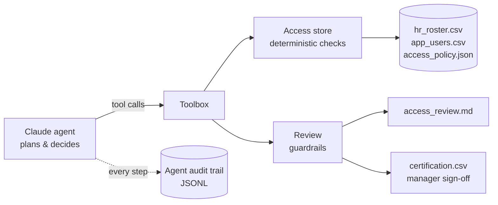

# Access Review Agent

An AI agent that performs a **periodic user access review (UAR)** for a financially significant application — reconciling application accounts against HR, enforcing segregation of duties and least privilege, and producing remediation decisions plus a **manager certification sheet**.

Built with Python and the Claude API (tool use). Runs fully offline in demo mode, no API key required.


## What it does

Inputs: an HR roster, the application's user/role export and an access policy (role matrix + SoD ruleset). The agent:

1. **Scopes** the review — population, roles, SoD rules, dormancy threshold.
2. **Runs five checks across every account:**

| Check | Finds |
|---|---|
| `terminated_with_access` | Leavers whose accounts are still active — and flags any **login after termination** |
| `orphan_accounts` | Human accounts with no HR match; service accounts with no accountable owner |
| `sod_conflicts` | Toxic role combinations (e.g. create vendor + approve payment) |
| `excess_privilege` | Roles not permitted for the user's department under the role matrix |
| `dormant_accounts` | No login within 90 days |

3. **Weighs all issues per account together** (pulling HR record, manager and permitted roles) and records **one remediation decision**: revoke, remove specific roles, review with manager, or accept with justification — with a risk rating and rationale.
4. **Produces** an audit report and a `certification.csv` routed to each user's manager for sign-off.

## Architecture



**Design choices that matter in an audit context**

- **Detection is deterministic; judgement is the agent's.** Every flag comes from plain Python in [`agent/access.py`](agent/access.py), so results are reproducible. The model decides remediation in context — e.g. *which* of two conflicting roles to remove based on the role matrix.
- **Guardrails.** The agent can only act on accounts a check actually flagged, can only remove roles the user actually holds, **cannot accept High-risk access** (it must escalate to a manager), and cannot close the review while any check is unrun or any flagged account is undecided.
- **The agent audits itself.** Every reasoning step and tool call goes to an append-only JSONL audit trail.
- **Human in the loop.** Output is a recommendation; managers certify via the CSV and a reviewer signs off.

## Quick start

```bash
git clone https://github.com/prasanthbabu87/access-review-agent.git
cd access-review-agent
pip install -r requirements.txt

python main.py --offline            # rule-based demo, no API key

export ANTHROPIC_API_KEY=sk-ant-...
python main.py                      # Claude-driven review; optional --model <model-id>

pytest -q                           # 13 tests
```

Output lands in `output/`. Pre-generated examples: [`sample_output/access_review.md`](sample_output/access_review.md), [`sample_output/certification.csv`](sample_output/certification.csv).

## Sample result

Synthetic FinanceERP dataset — 27 accounts, 23 HR records, review as of 30 Sep 2026:

- **13 accounts need action, 10 High risk**, including 5 revocations
- 3 leavers still active — one **logged in three weeks after termination**
- An unowned `temp_admin` account holding admin + payment approval
- AP clerk able to enter *and* approve payments; treasury manager able to create vendors *and* release payments
- A service account with payment-approval rights and no owner

## Project structure

```
agent/
  access.py       # data loading + deterministic access checks
  tools.py        # tool schemas exposed to Claude + dispatcher
  review.py       # decisions, guardrails, report + certification CSV
  llm_agent.py    # Claude tool-use loop + JSONL audit trail
  offline.py      # rule-based demo planner
data/             # synthetic data (no real people)
tests/            # pytest suite incl. mocked-LLM loop test
main.py           # CLI
```

## Disclaimer

All data is synthetic. This is a portfolio project demonstrating agentic AI applied to IT audit and identity governance; it is not a substitute for professional judgement.
